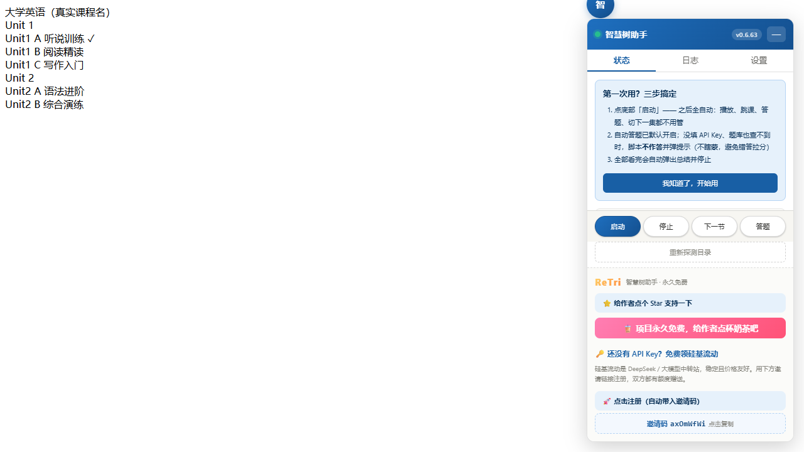

<p align="center">
  
</p>

<p align="center">
  <a href="#-从哪开始">从哪开始</a> · <a href="#-快速开始">安装</a> · <a href="#-和同类脚本比有什么不同">对比</a> · <a href="#-安全边界">安全边界</a> · <a href="README_EN.md">English</a> · <a href="docs/20-使用说明.md">完整文档</a>
</p>

<p align="center">
  <a href="LICENSE"></a>
  <a href="https://github.com/huanweide/zhihuishu-helper/actions/workflows/ci.yml"></a>
  <a href="https://github.com/huanweide/zhihuishu-helper/releases"></a>
  <a href="https://github.com/huanweide/zhihuishu-helper/stargazers"></a>
</p>

**装上 → 打开网课页 → 点「启动」→ 去睡觉。** 静音倍速自动播放、进度断了能接上、弹题自动答（答不上不瞎猜）。

一个专精智慧树 / 知到的 Tampermonkey 油猴脚本：把「学到哪、答什么、下一节是谁」这三件事替你记住并做完。全程跑在你自己的浏览器里，账号不经过任何第三方服务器。

<p align="center">
  
</p>
<p align="center"><sub>真实课程页面上的悬浮面板：状态 / 日志 / 设置，启动即托管</sub></p>

---

## 🧭 从哪开始

| 你的情况 | 从这里看 |
|---|---|
| 只想把课挂完 | [两步安装](#-快速开始) → 看完三条红线 |
| 想连作业 / 章节测试一起答 | [配置题库或 DeepSeek Key](docs/20-使用说明.md) |
| 担心账号安全 | [安全边界](#-安全边界) → [封禁风险调研](docs/08-封禁风险与技术路径调研.md) |
| 想改代码 / 加求解通道 | [参与开发](#-参与开发) → [PROJECT_MAP](docs/PROJECT_MAP.md) |

## ⚡ 30 秒看懂

| 你手动刷课 | 装上本脚本 |
|---|---|
| 忘了看到哪，进度条来回拖 | 自动恢复到上次位置（跨页面持久化，重启浏览器也记得） |
| 弹题卡住，瞎勾一个 C | 题库 → AI → 离线启发式三通道求解，全答不上就留空交给你 |
| 一节看完手动点下一节 | 自动切下一节、跳过已完成的 |
| 关掉浏览器进度靠记忆 | 进度写进本地存储，断网 / 断电 / 重启都接得回 |

**开箱即用**：自动播放 + 断点续播 + 课中弹题自动答，装上就生效，不用配任何 Key。
**想更强**（可选）：配一个题库服务或 DeepSeek API Key，作业 / 章节测试也能自动答。怎么配见 [使用说明](docs/20-使用说明.md)。

---

## 🆚 和同类脚本比，有什么不同

GitHub 上同类项目不少：[ocsjs/ocsjs](https://github.com/ocsjs/ocsjs)（多平台浏览器扩展）、[fuckZHS](https://github.com/VermiIIi0n/fuckZHS)（Python 协议流）、[Autovisor](https://github.com/CXRunfree/Autovisor)（Python 桌面程序）。它们都很强，选型看需求：

| | **本脚本** | OCS | fuckZHS / Autovisor |
|---|---|---|---|
| 形态 | 油猴脚本，浏览器原生跑 | 浏览器扩展 | Python 环境 / 桌面程序 |
| 上手门槛 | 装油猴 → 拖入脚本，两步 | 装扩展 + 配置 | 装 Python + 依赖 |
| 账号与数据 | **全程本地**，账号不交第三方 | 需自配题库服务 | 协议 / 自动化直连 |
| 答题策略 | 题库 → LLM → 离线启发式，**三通道全失手就留空** | 题库可配 | 各有取舍 |
| 断点续播 | ✅ 跨 iframe / 跨页面 / 重启浏览器都接得回 | — | — |
| 防作废 | 绝不 seek、倍速硬上限 1.5、验证码停手等人 | — | — |
| 检测特征 | 无 `navigator.webdriver` 标志 + 拟人节奏 | 取决于配置 | 协议流 / Playwright 特征明显 |
| 质量保障 | 762 项逻辑单测 + CI 门禁 + 5 套页面版本适配 | 社区维护 | 社区维护 |

一句话定位：**OCS 适合多平台通吃；fuckZHS / Autovisor 适合愿意折腾 Python 的；本项目适合「只想把智慧树挂完、还要保住学习记录」的人。**

---

## ⚡ 核心特性

- **🔁 断点续播引擎** —— 进度写进 `GM_setValue`（跨 iframe / 落盘持久化），关页面、断网、重启浏览器都从上次位置继续。`src/04-resume.js`
- **🎯 不瞎蒙闸门** —— 答案必须来自题库 / LLM / 离线启发式三条真实通道之一，全拿不到就留空转人工；所有"随机猜"路径默认关闭。`src/11-solver.js`
- **🧭 五套页面适配** —— 智慧树 5 套并存页面结构统一适配；改版导致选择器失效时自动启用结构兜底扫描。`src/02-adapter.js`
- **🐕 防卡死看门狗** —— 整体无进展但没触发器命中的盲区也能被抓到并逐级恢复。`src/02d-guard.js`
- **🛡️ 守株待兔式作业模式** —— 只在你已身处作业 / 考试页时才作答，绝不主动导航过去。`src/06c-exam.js`
- **🤖 人类化防检测** —— 你在场时主动让权、随机思考延迟、抖动主循环、拟人随机暂停，拉平"挂机"特征。`src/15-presence.js`
- **📊 真实统计** —— 今天答了几题、答案各来自哪条通道、学了多久，逐条可查。`src/14-stats.js`

21 个模块的完整链路图见 [PROJECT_MAP](docs/PROJECT_MAP.md)，平台侦察与选择器实测见 [开发者笔记](docs/40-开发者笔记.md)。

---

## ⚡ 快速开始

### 安装（两步）

1. 装 [Tampermonkey](https://www.tampermonkey.net/)（Chrome / Edge / Firefox 都行）
2. 打开 [jsDelivr 一键安装直链](https://cdn.jsdelivr.net/gh/huanweide/zhihuishu-helper@master/dist/zhihuishu-helper.user.js) → 点油猴弹出的「安装」

装好后打开任意智慧树课程页，右下角出现控制面板即成功；没出现先看 [安装说明](docs/20-使用说明.md)。

也可以到 [Releases](https://github.com/huanweide/zhihuishu-helper/releases) 下载 `zhihuishu-helper.user.js` 拖进浏览器。要改代码才需要走源码构建：`git clone` 后 `npm install && node build.js`，详见 [安装说明](docs/20-使用说明.md)。

### 用起来

```bash
打开网课页 → 点面板「启动」→ 收工
=== 课程体检 ===
共 24 个节点：已完成 18 / 未看完 5 / 未解锁 1（完成度 75%）
[智慧树助手] 静音 + 倍速 1.5 + 防暂停已就绪
[智慧树助手] 已恢复到上次位置 12:40（跨 iframe 持久化）
[智慧树助手] 弹题：命中题库（通道=bank）→ 已回填并校验通过
[智慧树助手] 本节结束，自动切下一节
```

### 使用前必读（三条红线，违反会丢进度）

1. **浏览器可以缩小，但别最小化** —— 最小化会把定时器节流到 ~1 次/分钟，主循环冻结。
2. **别把倍速调到 1.5 以上** —— 更高倍速会被平台盯上，进度不记录。
3. **别用于正式监考考试** —— 脚本只辅助平时作业 / 章节练习 / 单元测试；考试页严格守株待兔，绝不代答监考卷。

### 控制台 API（按 F12）

| 命令 | 用途 | 命令 | 用途 |
|------|------|------|------|
| `zhs.start()` | 启动主循环 | `zhs.stop()` | 停止自动化 |
| `zhs.next()` | 手动切下一节 | `zhs.stats()` | 课程完成统计 |
| `zhs.config({speed:1.5})` | 改配置 | `zhs.clearResume()` | 清续播记录 |
| `window.ZHS.Bank.ping()` | 测题库连通 | `window.ZHS.LLM.test()` | 测 LLM 连通 |

---

## 🔧 参与开发

- **架构**：21 模块按「识别 → 播放 → 答题 → 切集」链路拼装，每层只做一件事且有降级路径，主循环每 2 秒一 tick。完整模块地图与端到端链路图见 [PROJECT_MAP](docs/PROJECT_MAP.md)。
- **加一个你自己的求解通道**：求解层是「通道列表 + 依次尝试」，加通道不用碰播放和调度：

```js
// 在 src/11-solver.js 的通道链里插入你自己的通道
ZHS.Solver.channels.push({
  name: 'my-bank',
  async solve(q) {                       // q = { question, options[], type }
    const r = await fetch('https://my-bank.example/search', {
      method: 'POST',
      headers: { 'Content-Type': 'application/json' },
      body: JSON.stringify({ question: q.question, options: q.options, type: q.type })
    });
    const d = await r.json();
    return d.answer ? { answer: d.answer, source: 'my-bank' } : null;  // 拿不到必须返回 null
  }
});
```

> 铁律：你的通道拿不到答案时**必须返回 `null`**，绝不能返回随机选项——这是「不瞎蒙」闸门的地基。

- **改完代码必跑的门禁**：

```bash
node build.js                      # 构建：src/*.js 按序拼装 → dist/*.user.js
node tools/check-dist-fresh.js     # dist 与 src 一致性
node test/run.js                   # 逻辑单测（762 项，jsdom）
node tools/check-docs-consistency.js --tests 762   # 文档数字不漂移
```

> 门禁基线：当前 **v0.6.69**，通过 762 / 失败 0——README 与文档里的版本号、测试数由第 ⑤ 条命令机器把关。

- **欢迎的贡献**：报 bug（带日志与页面版本代号）、适配新页面版本、新增求解通道、补文档翻译、补测试用例。开工前读 [贡献指南](CONTRIBUTING.md)（含四条不可触碰红线），参与即同意 [行为准则](CODE_OF_CONDUCT.md)。

---

## 🛡️ 安全边界

| 会做 | 永远不会 |
|---|---|
| 播放、暂停、切下一节（优先点平台原生按钮） | 自动跳转到作业页 / 考试页（只守株待兔，你人到了它才动） |
| 记住进度，跨 iframe / 跨页面 / 重启恢复 | seek（拖动）播放器进度——拖动必触发腾讯 Turing 滑块 |
| 从题库 / LLM / 离线启发式取答案 | 替你瞎蒙：三通道全失手就留空交人工 |
| 把 API Key 存在本地油猴配置 | 收集或上传任何凭据 |
| 你在操作时主动让权 | 代答监考考试（代码级红线，不是口头承诺） |

仅限个人学习研究使用，禁止商用与传播；使用风险自负，并请遵守智慧树平台条款与所在学校规定。

---

## 🗺️ 路线图

- [x] 自动播放 / 断点续播 / 三通道答题 / 全自动学习引擎 / 人类化防检测 / 温和交互层（所有播放控制优先点平台原生按钮）/ 762 项单测 + 70 项截屏测试 / 五套页面版本适配
- [ ] 更多平台的题库协议适配（目前支持 `TikuAdapter` 标准协议）
- [ ] 章节测试的批量导出与复盘
- [ ] 真机 E2E 纳入 CI（当前依赖真机 Chrome，仅本地跑）

---

## 📚 文档

| 文档 | 内容 |
|------|------|
| [安装与使用说明](docs/20-使用说明.md) | 3 步装好、配置说明、常见问题 |
| [自动学习引擎方案](docs/30-自动学习引擎方案.md) | 全自动学习链路设计与红线边界 |
| [平台侦察报告](docs/01-侦察报告.md) | 页面结构、选择器、实测结论 |
| [踩坑记录](docs/03-踩坑记录.md) | 真机问题与排查顺序 |
| [GitHub 生态调研](docs/06-GitHub生态全景调研.md) | 50+ 竞品横向对比 |
| [Greasyfork 发布指引](docs/07-Greasyfork发布指引.md) | 油猴站上架步骤与双源同步 |
| [更新日志](CHANGELOG.md) | 每个版本改了什么、为什么 |

---

## License

[MIT](LICENSE) © huanweide

## ⭐ Star

如果这个脚本帮你把网课挂完了，点个 Star 就是最大的支持——它决定了更多被网课折磨的人能不能看到它。

[](https://github.com/huanweide/zhihuishu-helper)

## 🧰 作者的其他开源工具

📚 [novel-smith](https://github.com/huanweide/novel-smith)（AI 长篇网文工坊）· 🎬 [bili-subtitle-universal](https://github.com/huanweide/bili-subtitle-universal)（B站字幕一键提取）· 📺 [live-subtitle](https://github.com/huanweide/live-subtitle)（实时字幕）· ✂️ [video-brief](https://github.com/huanweide/video-brief)（长视频摘要）· 🩺 [family-showcase](https://github.com/huanweide/family-showcase)（代码健康全家桶）· [全部仓库 →](https://github.com/huanweide?tab=repositories)
