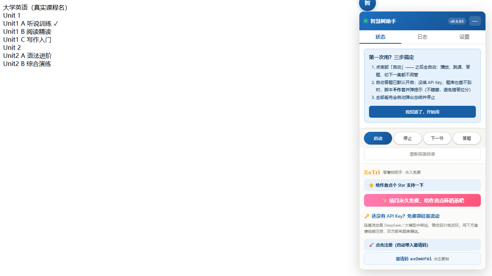

# 智慧树网课助手（zhihuishu-helper）

[](LICENSE)
[](https://github.com/huanweide/zhihuishu-helper/actions/workflows/ci.yml)
[](https://github.com/huanweide/zhihuishu-helper/releases)
[](https://github.com/huanweide/zhihuishu-helper/stargazers)
[](https://github.com/huanweide/zhihuishu-helper/commits/master)
[](CONTRIBUTING.md)

> **一句话定位**：一个 **Tampermonkey 油猴脚本**，让你在 **智慧树 / 知到** 上 **自动播放、断点续播、AI 自动答题（不瞎蒙）** —— 装好即用，全程在你的浏览器里跑，账号不交给任何第三方。

**适合谁用**：被智慧树网课折磨的大学生；想挂课 / 刷课又想保住学习记录、但不愿把账号交给云端自动化脚本的人。

**3 步装好（需 Node 环境构建一次）**：① 装 [Tampermonkey](https://www.tampermonkey.net/) 浏览器插件 → ② `git clone` 后 `node build.js` 生成 `dist/zhihuishu-helper.user.js` → ③ 用 Tampermonkey 打开该文件即装。完整图文见 [安装说明](docs/20-使用说明.md)。

**三条主线能力**

| 能力 | 说明 | 本项目独有亮点 |
|------|------|----------------|
| 🎬 自动播放 | 自动静音 + 倍速 + 防暂停 + 自动下一节/章 | 关掉页面也不丢进度 |
| ⏯ 断点续播 | 关页面 / 浏览器 / 断网后重开，自动从上次位置继续 | 跨课、跨 iframe 持久化（ocsjs / cxmooc-tools 都没有） |
| 🤖 AI 自动答题 | 课中弹题 + 章节测试 + 作业：题库优先 → LLM 兜底 → 自动回填 | **不瞎蒙**：无可靠答案转人工，绝不随机勾；LLM 超时给足 45s/70s |

**为什么不直接用 ocsjs / cxmooc-tools？** 它们适配更广，但本项目多三件你大概率用得上的事：① **断点续播**（它们没有）；② **故障可诊断**（超时 / 断网 / HTTP / HTML 四类分层提示 + 解决建议）；③ **通道健康检测**（一键点检题库 + 模型两条通道，逐条给原因）。完整对比看下方 [能力 Benchmark](docs/40-开发者笔记.md#72-与参考项目的能力-benchmark)。

**真实运行界面**（脚本注入网课页面后的实际效果，非效果图）：



面板提供：一键「启动」全自动刷课、状态 / 日志 / 设置三标签页、弹题自动答题、章节目录探测，并明确标注「永久免费」。

> ⚠️ 仅限个人学习研究使用，禁止商用与传播；使用风险自负。下方是按"开发者笔记"组织的完整内容（能力矩阵 / 技术方案 / 测试门禁 / 踩坑记录），想先上手直接看 [安装说明](docs/20-使用说明.md)。

## 一、项目目标（三条主线）

| 编号 | 功能 | 说明 | 优先级 |
|------|------|------|--------|
| F1 | 自动播放 | 自动静音 + 倍速 + 防暂停 + 自动下一节/下一章 | P0 |
| F2 | 断点续播 | 关闭页面/浏览器/断网后重新打开，自动从上次位置继续 | P0 |
| F3 | AI 自动答题 | 课中弹题 + 章节测试 + 作业，OCR/文本取题 → LLM 生成答案 → 自动勾选 | P1 |
| F4 | 全自动学习引擎 | `autoLearn` 总开关默认开启：进课程中心即自动选未完成课并续播、学完自动进下一门；支持 `zhs.gotoLesson(n\|标题)` 跳指定课时、面板「跳到指定课时 / 找下一门课」 | P0 |

---

## 二、开发者笔记（已外置）

> 这三部分是**开发者向内容**：智慧树 5 套页面的选择器实测表、9 个参考项目调研、断点续播与 AI 答题的方案设计。
> 已外置到 **[docs/40-开发者笔记.md](docs/40-开发者笔记.md)** —— 改代码或适配新页面时看它，只想装来用可跳过。

---

## 三、目录结构

```
zhihuishu-helper/
├── README.md              # 本文件：调研结论 + 方案设计
├── CHANGELOG.md           # 更新日志（含踩坑与限制）
├── build.js               # 构建：src/*.js 按序拼装 → dist/*.user.js
├── docs/
│   ├── PROJECT_MAP.md     # 项目索引：文档地图 + 代码地图 + 速查
│   ├── 01-侦察报告.md      # 平台页面结构与选择器明细
│   ├── 02-技术方案.md      # 详细设计（本 README 第四章的展开）
│   ├── 03-踩坑记录.md      # 20 个实测问题（现象/根因/解决/来源）
│   ├── 11-测试报告.md      # 两层测试体系 + 断言明细
│   ├── 20-使用说明.md      # 安装、面板、控制台 API、排障手册
│   └── 90-快照与回溯.md    # 三层快照机制
├── src/                   # 正式源码（20 模块，按序拼装）
├── test/                  # 测试：逻辑单测 + 截屏测试 + 真实站点测试
│   ├── run.js             #   逻辑单测 706 项（jsdom + vm 模块注入）
│   ├── screenshot.js      #   截屏测试 70 项（puppeteer-core + Chrome）
│   ├── live-run.js        #   真实站点测试入口（login/recon/e2e）
│   ├── fixture-media.js   #   媒体打桩（解决 duration=Infinity）
│   └── fixture-*.html     #   仿真页面
├── tools/
│   ├── snapshot.sh        #   三层快照
│   ├── probe.js           #   内部状态诊断
│   └── verify-exam.js     #   在线作业/考试作答页验收（35 项断言）
├── dist/                  # 构建产物（git 忽略）
├── reference/             # 参考项目源码 + 实测抓取（只读，git 忽略）
└── snapshot/              # 项目快照（tar/bundle，git 忽略）
```

### 快速开始

```bash
node build.js                                    # 构建
node test/run.js                                 # 逻辑单测（706 项）
node test/screenshot.js                          # 截屏测试（70 项）
node test/live-run.js login                      # 真实站点：人工登录
node test/live-run.js e2e                        # 真实站点：端到端测试
```

安装使用见 **[`docs/20-使用说明.md`](docs/20-使用说明.md)**。

---

## 四、里程碑 / 质量度量

> 里程碑清单、测试门禁演进曲线、与 ocsjs / cxmooc-tools 的能力 Benchmark、能力矩阵图，
> 已外置到 **[docs/40-开发者笔记.md](docs/40-开发者笔记.md)**。

---

## 五、免责声明

本项目仅供**个人学习与技术研究**，用于理解浏览器自动化、DOM 操作、LLM 应用集成。
使用者应遵守智慧树平台服务条款及其所在学校规定。因使用本项目产生的任何后果，
由使用者自行承担。

---

## 📚 文档

| 文档 | 内容 |
|------|------|
| [安装与使用说明](docs/20-使用说明.md) | 3 步装好、配置说明、常见问题 |
| [自动学习引擎方案](docs/30-自动学习引擎方案.md) | 全自动学习链路设计与红线边界 |
| [平台侦察报告](docs/01-侦察报告.md) | 4 套页面结构、选择器、实测结论 |
| [技术方案](docs/02-技术方案.md) | 模块架构、三条主线设计 |
| [踩坑记录](docs/03-踩坑记录.md) | 真机问题与排查顺序 |
| [GitHub 生态调研](docs/06-GitHub生态全景调研.md) | 同类项目横向对比 |
| [开发者笔记](docs/40-开发者笔记.md) | 平台侦察（5 套页面选择器）+ 参考项目调研 + 技术方案 + 里程碑 + 能力 Benchmark |
| [模块地图](docs/PROJECT_MAP.md) | 20 个模块按链路排列 + 四条门禁命令 |
| [更新日志](CHANGELOG.md) | 每个版本改了什么、为什么 |

## 🤝 参与贡献

欢迎 PR 与 issue。开工前请先读 [贡献指南](CONTRIBUTING.md)——里面写了模块结构、四条门禁命令、
以及**四条不可触碰的红线**（尤其"绝不自动跳考试页"与"绝不替用户瞎蒙答案"）。

提 bug 请附上脚本版本号、页面版本代号（wisdom / fusion / hike / legacy）和面板日志页内容。

---

## 作者

由 **ReTri · 樊斯瑞** 维护 · [GitHub 主页](https://github.com/huanweide)

## 赞助支持

如果这个项目帮到了你，欢迎 [点 Star](https://github.com/huanweide/zhihuishu-helper) 支持；也可微信扫码自愿赞助（收款码见 `sponsor/wechat-qr.png`，作者本人带 Tri 水印的码，纯静态图片、不含任何密钥）。
---


## 🧰 更多开源工具（by ReTri · 樊斯瑞）

- 🎬 字幕 / 视频：[bili-subtitle-universal](https://github.com/huanweide/bili-subtitle-universal) · [live-subtitle](https://github.com/huanweide/live-subtitle) · [zhihuishu-helper](https://github.com/huanweide/zhihuishu-helper) · [video-brief](https://github.com/huanweide/video-brief)
- 🩺 代码健康全家桶（18 轴零依赖 CLI）：[family-showcase](https://github.com/huanweide/family-showcase)
- ✍️ 写小说：[novel-smith](https://github.com/huanweide/novel-smith) · AI 小说工坊（本地优先，零云端依赖）
- 🔧 命令行利器：[idiot-index](https://github.com/huanweide/idiot-index) · [recall-cli](https://github.com/huanweide/recall-cli) · [forge-safeguard](https://github.com/huanweide/forge-safeguard-20260812)
- 🖥️ 桌面 / 资讯：[floatsnip](https://github.com/huanweide/floatsnip) · [tech-news-hub](https://github.com/huanweide/tech-news-hub)
- 📦 全部仓库：<https://github.com/huanweide?tab=repositories>
