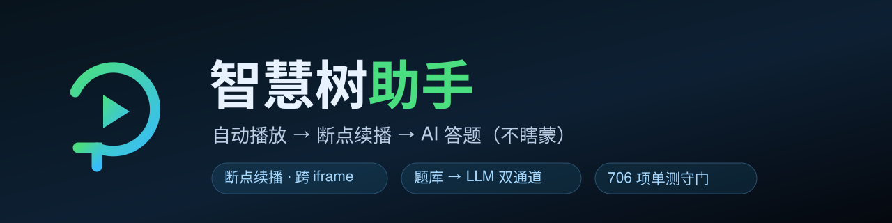
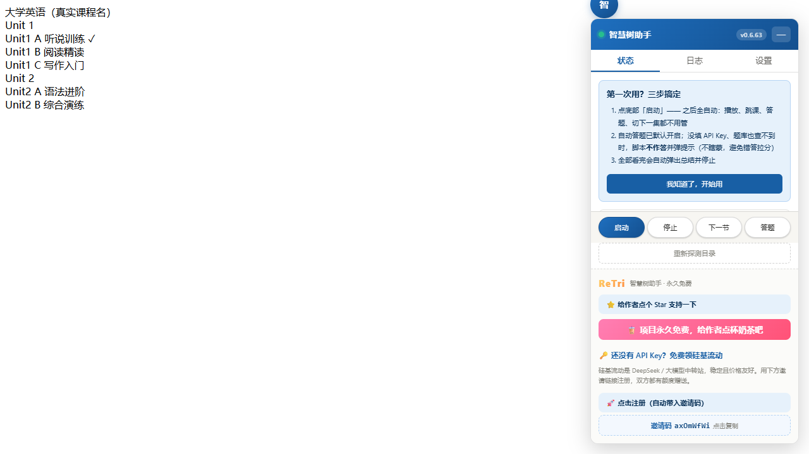

**中文** · [README.md](./README.md)

<p align="center">
  
</p>

<p align="center">
  <a href="#-quick-start">Install</a> · <a href="#-how-it-compares">Comparison</a> · <a href="#-security-boundary">Security Boundary</a> · <a href="./README.md">中文</a>
</p>

<p align="center">
  <a href="LICENSE"></a>
  <a href="https://github.com/huanweide/zhihuishu-helper/actions/workflows/ci.yml"></a>
  <a href="https://github.com/huanweide/zhihuishu-helper/releases"></a>
  <a href="https://github.com/huanweide/zhihuishu-helper/stargazers"></a>
</p>

**Install → open the course page → click "Start" → go to sleep.** Muted speed-up auto-play, resumable progress, auto-answering of popup questions (never a blind guess) — all inside your own browser, your account never passes through any third-party server.

A Tampermonkey userscript dedicated to Zhihuishu (智慧树 / 知到). In one line: it remembers and finishes the three things "where am I / what do I answer / who's next" for you.

<p align="center">
  
</p>
<p align="center"><sub>The floating panel on a real course page: status / logs / settings — start and it takes over</sub></p>

---

## ⚡ 30-Second Overview

| Grinding manually | With this script |
|---|---|
| Forgot where you were, dragging the bar back and forth | Auto-resumes to your last position (persisted across pages and browser restarts) |
| Popup blocks playback; you blindly tick a C | Solved via bank → LLM → offline heuristic; if all fail it leaves it blank for you |
| Clicking the next section after each one | Auto-advances, skipping finished nodes |
| Progress depends on memory | Progress stored locally; network drop / reboot / restart all pick up where you left |

**Works out of the box**: auto-play + resume + in-course popup answering — zero configuration.
**Optional boost**: configure a question bank or a DeepSeek API key to also answer homework / chapter tests. See the [Usage Guide](docs/20-使用说明.md).

---

## 🆚 How It Compares

Similar projects on GitHub: [ocsjs/ocsjs](https://github.com/ocsjs/ocsjs) (multi-platform browser extension), [fuckZHS](https://github.com/VermiIIi0n/fuckZHS) (Python protocol client), [Autovisor](https://github.com/CXRunfree/Autovisor) (Python desktop app). All solid — pick by need:

| | **This script** | OCS | fuckZHS / Autovisor |
|---|---|---|---|
| Form | userscript in your daily browser | browser extension | Python environment / desktop app |
| Setup | install Tampermonkey → drag the script, two steps | extension + config | install Python + deps |
| Account & data | **100% local**, no third party | bring your own bank service | protocol / automation direct |
| Stealth | `navigator.webdriver=false` natively + human-like pacing | depends on config | protocol fingerprint / Playwright webdriver flag |
| Answering | bank → LLM → offline heuristic; **all fail → blank, never a guess** | bank configurable | trade-offs vary |
| Resume | ✅ cross-iframe / cross-page / browser restart | — | — |
| Anti-voiding | **never seeks** (dragging triggers captcha), speed hard-capped at 1.5×, captcha = hands off | — | — |
| Proctored exams | **strictly untouched** (a code-level red line, not a promise) | — | — |
| Quality | 742 logic unit tests + CI gates + 5 page-version adapters | community | community |

One-line positioning: **OCS for multi-platform coverage; fuckZHS / Autovisor if you're comfortable with Python; this one if you just want Zhihuishu done while keeping your study records.**

---

## ⚡ Core Features

- **🔁 Resume Engine** — progress in `GM_setValue` (cross-iframe, persisted); page close, network drop, browser restart all resume. `src/04-resume.js`
- **🎯 No-Guess Gate** — answers must come from bank / LLM / offline heuristic; none → blank for a human. All "random guess" paths off by default. `src/11-solver.js`
- **🧭 Five Version Adapters** — Zhihuishu's 5 coexisting page structures unified; on redesign, a structural fallback scan kicks in. `src/02-adapter.js`
- **🐕 Stall Watchdog** — catches "no overall progress, no trigger fired" blind spots, escalating recovery. `src/02d-guard.js`
- **🛡️ Passive Exam Mode** — answers only when you are already on the homework / exam page; never navigates there. `src/06c-exam.js`
- **🤖 Humanized Anti-Detection** — yields when you're present; randomized thinking delay, jittered loop, human-like random pauses. `src/15-presence.js`
- **📊 Honest Stats** — how many answered today, from which channels, how long studied — traceable line by line. `src/14-stats.js`

Full module map: [PROJECT_MAP](docs/PROJECT_MAP.md); platform recon & selector notes: [Developer Notes](docs/40-开发者笔记.md).

---

## ⚡ Quick Start

### Install (two steps)

1. Install [Tampermonkey](https://www.tampermonkey.net/) (Chrome / Edge / Firefox)
2. Open the [jsDelivr one-click install link](https://cdn.jsdelivr.net/gh/huanweide/zhihuishu-helper@master/dist/zhihuishu-helper.user.js) → click "Install"

Or grab `zhihuishu-helper.user.js` from [Releases](https://github.com/huanweide/zhihuishu-helper/releases) and drag it into the browser. Building from source: `git clone`, `npm install`, `node build.js` — see the [Usage Guide](docs/20-使用说明.md).

### Read before use (three rules, violating them voids progress)

1. **Shrink the window, don't minimize it** — minimization throttles timers to ~1/min, freezing the main loop.
2. **Keep speed ≤ 1.5×** — higher speeds get flagged; progress won't be recorded.
3. **Never use it on proctored exams** — everyday homework / chapter exercises / unit tests only; exam pages are strictly sit-and-wait.

### Console API (press F12)

| Command | Purpose | Command | Purpose |
|------|------|------|------|
| `zhs.start()` | start the main loop | `zhs.stop()` | stop automation |
| `zhs.next()` | next unfinished section | `zhs.stats()` | completion stats |
| `zhs.config({speed:1.5})` | change config | `zhs.clearResume()` | clear resume record |
| `window.ZHS.Bank.ping()` | test bank channel | `window.ZHS.LLM.test()` | test LLM channel |

---

## 🔧 Development

- **Architecture**: 21 modules chained along "detect → play → answer → advance", each doing one thing with a degradation path; the main loop ticks every 2s. Full map: [PROJECT_MAP](docs/PROJECT_MAP.md).
- **Add your own solver channel** — no need to touch playback or scheduling:

```js
// Insert into the channel chain in src/11-solver.js
ZHS.Solver.channels.push({
  name: 'my-bank',
  async solve(q) {                       // q = { question, options[], type }
    const r = await fetch('https://my-bank.example/search', {
      method: 'POST',
      headers: { 'Content-Type': 'application/json' },
      body: JSON.stringify({ question: q.question, options: q.options, type: q.type })
    });
    const d = await r.json();
    return d.answer ? { answer: d.answer, source: 'my-bank' } : null;  // null when unsolved
  }
});
```

> Iron rule: your channel **must return `null` when it can't answer** — never a random option. This is the foundation of the "no blind guessing" gate.

- **Mandatory gates after changing code**:

```bash
node build.js                      # build: src/*.js → dist/*.user.js
node tools/check-dist-fresh.js     # dist matches src
node test/run.js                   # logic unit tests (jsdom)
node tools/check-docs-consistency.js --tests 742   # doc numbers don't drift
```

> Gate baseline: currently **v0.6.68**, passed 742 / failed 0.

- **Contributions welcome**: bug reports (with logs and page-version code), new page-version adapters, solver channels, docs / translation, test cases. Read [CONTRIBUTING.md](CONTRIBUTING.md) (four untouchable red lines) before starting; participating means agreeing to the [Code of Conduct](CODE_OF_CONDUCT.md).

---

## 🛡️ Security Boundary

This project will **never**:

1. **Auto-navigate to homework / exam pages** — sit-and-wait only: it acts when you arrive.
2. **Seek (drag) the player progress** — dragging triggers the Tencent Turing slider captcha; progress recovery re-clicks the section title and lets the platform position itself.
3. **Blindly guess answers** — better blank than wrong.
4. **Collect any credentials** — API keys live only in your local Tampermonkey config.

For personal study and research only; commercial use and distribution prohibited; use at your own risk, complying with Zhihuishu's terms and your school's regulations.

---

## 🗺️ Roadmap

- [x] Auto-play / resume / three-channel answering / full auto-learning engine / humanized anti-detection / 742 unit tests + 70 screenshot tests / five page-version adapters
- [ ] More question-bank protocol adapters (currently `TikuAdapter` standard protocol)
- [ ] Batch export & review of chapter tests
- [ ] Real-device E2E in CI (currently local Chrome only)

---

## 📚 Documentation

| Document | Content |
|------|------|
| [Install & Usage Guide](docs/20-使用说明.md) | 3-step install, config, FAQ |
| [Auto-Learning Engine Plan](docs/30-自动学习引擎方案.md) | full auto-learning chain design and red-line boundaries |
| [Platform Recon Report](docs/01-侦察报告.md) | page structure, selectors, tested conclusions |
| [Pitfall Log](docs/03-踩坑记录.md) | real-device issues and troubleshooting order |
| [GitHub Ecosystem Survey](docs/06-GitHub生态全景调研.md) | horizontal comparison of 50+ similar projects |
| [Changelog](CHANGELOG.md) | what changed and why each version |

---

## License

[MIT](LICENSE) © huanweide

## ⭐ Star

If this script finished your courses, a Star is the biggest support — it decides how many other course-tortured students can find it.

[](https://github.com/huanweide/zhihuishu-helper)

## 🧰 Other Open-Source Tools by the Author

📚 [novel-smith](https://github.com/huanweide/novel-smith) (AI long-form novel workshop) · 🎬 [bili-subtitle-universal](https://github.com/huanweide/bili-subtitle-universal) (Bilibili subtitle extractor) · 📺 [live-subtitle](https://github.com/huanweide/live-subtitle) (live captions) · ✂️ [video-brief](https://github.com/huanweide/video-brief) (long-video summarizer) · 🩺 [family-showcase](https://github.com/huanweide/family-showcase) (code-health suite) · [All repositories →](https://github.com/huanweide?tab=repositories)
